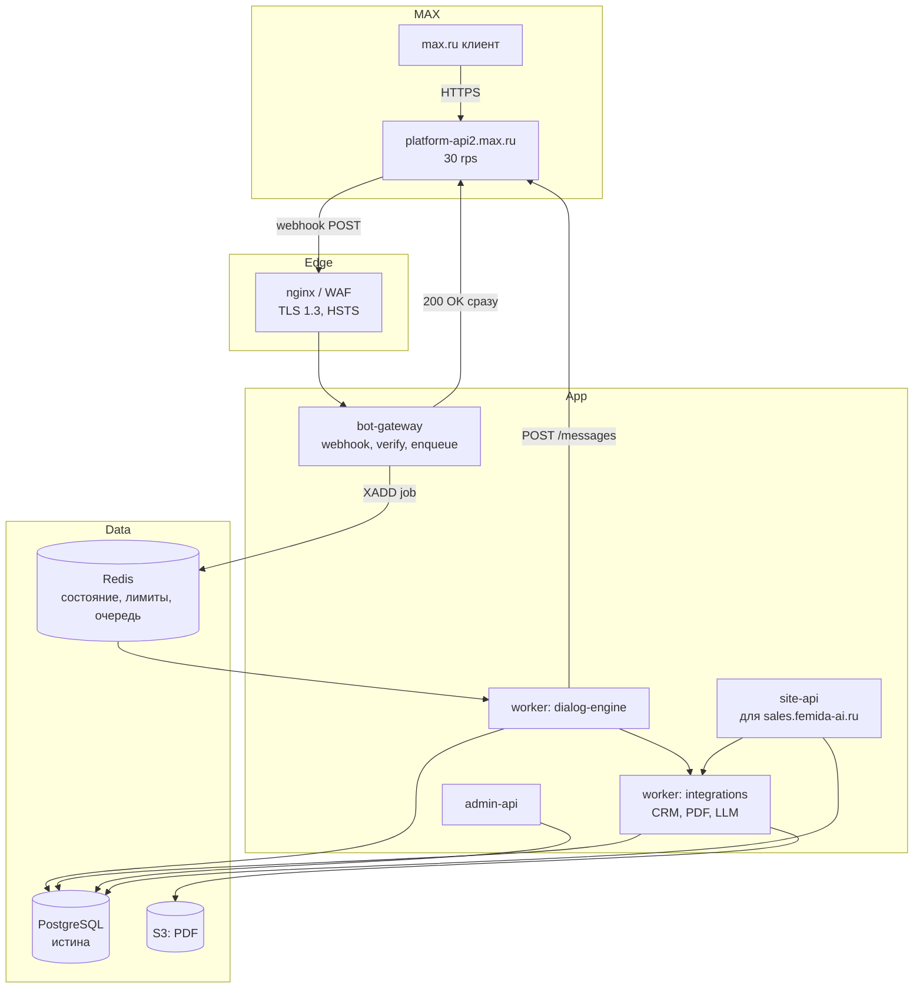
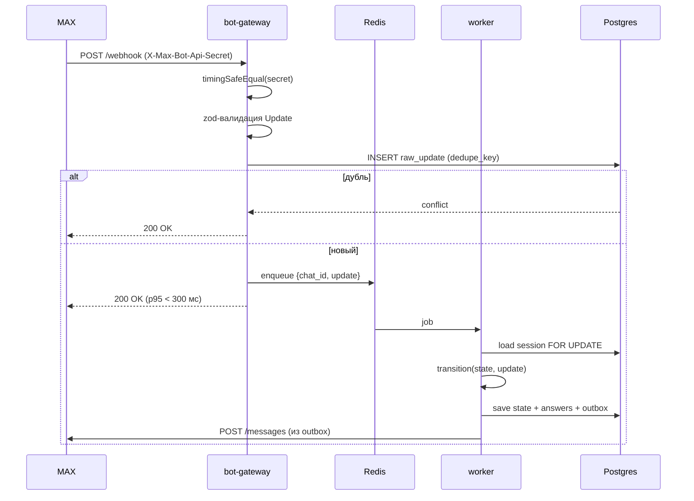

# Архитектура

## Общая схема



## Компоненты

| Компонент | Ответственность | Масштабирование |
|---|---|---|
| `bot-gateway` | принять webhook, проверить secret, провалидировать, записать raw, отдать 200, поставить job | stateless, 2+ реплики |
| `dialog-engine` | состояние, переходы, рендер сообщений, чек-лист | по `chat_id` |
| `integrations` | CRM, PDF, LLM, письма сайту | по типу job |
| `admin-api` | сценарии, документы, публикация, баны, просмотр сессий | 1–2 реплики |
| `site-api` | чек-лист для сайта, лиды, обмен с ботом | 2+ реплики |
| `scheduler` | напоминания, ретраи, очистка | singleton с локом |

## Поток webhook



Почему так:

- MAX ждёт **200 в течение 30 секунд**, иначе повторяет доставку (10 попыток,
  экспоненциально, до 8 часов, потом отписывается). Мы не работаем внутри запроса.
- Ретраи MAX + наши ретраи = дубли. Отсюда обязательная идемпотентность на входе.
- Порядок событий не гарантирован → сериализуем обработку **по chat_id**.

## Идемпотентность

У MAX нет отдельного `update_id`, поэтому ключ строим сами. В ключ берём
**стабильные** поля, а не весь payload и не `timestamp`:

```
// нажатие кнопки: callback.timestamp — время нажатия, а не доставки.
// Оно стабильно при ретрае и различает повторные нажатия той же кнопки.
dedupe_key = sha256(
  "message_callback:" + chat_id + ":" +
  callback.callback_id + ":" + callback.timestamp + ":" +
  callback.user.user_id + ":" + (callback.payload ?? "")
)

// новое сообщение: mid уникален
dedupe_key = sha256("message_created:" + chat_id + ":" + message.body.mid)

// редактирование: тот же mid, поэтому добавляем время сообщения
dedupe_key = sha256(
  "message_edited:" + chat_id + ":" + message.body.mid + ":" + message.timestamp
)

// служебные события без идентификатора: тип + чат + время события
dedupe_key = sha256(update_type + ":" + chat_id + ":" + timestamp)
```

Почему не `message.body.mid + callback.payload`: у одного сообщения `mid` не
меняется, а payload кнопки — тоже. Два разных нажатия «Да» на одном сообщении
получили бы одинаковый ключ, и второе нажатие потерялось бы. `callback.timestamp`
решает это и при этом не зависит от повторной доставки.

`Update.timestamp` — запасной вариант для событий без `mid`/`callback_id`. Ключ
должен описывать **событие**, а не момент его доставки.

- `raw_updates.dedupe_key` — `UNIQUE`.
- Повторный webhook получает 200 и ничего не делает.
- `timestamp` старше 10 минут не блокируем, но помечаем `late` и не выполняем
  повторные чувствительные действия (лид, оплата).
- Исходящие сообщения идут через **outbox**: запись в БД в одной транзакции с
  изменением состояния, отдельный воркер отправляет и помечает.
- Отправка — `at-least-once`. Чтобы не спамить при таймауте, на чат держим
  in-flight lock и сверяемся с последними сообщениями через `GET /messages`.

## Состояние диалога

```
Session {
  id, public_id,       // public_id — ULID для ссылок, не внутренний UUID
  user_id, scenario_code, scenario_version, catalog_version,
  state: jsonb,        // ответы + текущий шаг + флаги
  version: int,        // optimistic lock
  status: active | completed | abandoned | blocked,
  updated_at
}
```

Переход выполняется так:

```sql
SELECT * FROM sessions WHERE id = $1 FOR UPDATE;   -- или version = $2
-- pure function: transition(catalog, state, event) -> {state', outbox[]}
UPDATE sessions SET state = $3, version = version + 1 WHERE id = $1 AND version = $2;
```

`transition` — **чистая функция без I/O**. Это позволяет покрыть тестами все ветки
и проигрывать любой диалог из фикстуры.

## Асинхронность: что именно проверяем

| Гарантия | Как достигаем | Как проверяем |
|---|---|---|
| Webhook отвечает быстро | только валидация + enqueue | нагрузочный тест 300 rps, p95 < 300 мс |
| Нет двойных сообщений | dedupe_key, UNIQUE | реплей 100 одинаковых webhook |
| Нет потерянных событий | raw пишем до 200, job в Redis с AOF | kill -9 воркера в середине обработки |
| Нет гонок по чату | очередь partitioned by chat_id | 20 параллельных callback одного чата |
| Нет зависших сессий | TTL job, heartbeat, visibility timeout | тест с «зависшим» воркером |
| Долгие операции не блокируют | отдельные job + `action: typing` | PDF/LLM под нагрузкой |

## Хранилища

### PostgreSQL
Источник истины: пользователи, сессии, ответы, документы, сценарии, лиды,
raw_updates, outbox, audit. Схема — в `db/schema.sql`.

`raw_updates.payload` содержит полный входящий `Update`, включая текст сообщения.
Это потенциальные ПД: хранить 30 дней, шифровать диск, не выгружать в общие логи,
доступ — только сервисной роли.

Партиционирование `raw_updates` и `audit_log` по месяцу — после 10 млн строк.

### Redis
- сессии hot-кэш (30 мин sliding, write-through);
- очередь BullMQ;
- rate limit счётчики;
- идемпотентные ключи отправки;
- кэш рендера чек-листа;
- распределённые локи по `chat_id`.

### S3
PDF-чек-листы, сгенерированные один раз, ссылка с TTL 7 дней.
Сканы документов **не принимаем** в MVP.

## Деплой

```
Интернет → WAF/CDN → LB (443) → app (2+ пода)
                                  ├─ gateway
                                  ├─ worker
                                  └─ admin (за VPN/allowlist)
Postgres (managed, daily backup, PITR 7 дней)
Redis (managed, AOF)
S3 (версионирование, шифрование)
```

Требования, которые нельзя обойти:

- webhook **только HTTPS на 443**, сертификат от доверенного ЦС (в т.ч. Минцифры),
  полная цепочка. Самоподписанные и HTTP запрещены с 25.05.2026.
- исходящие к `platform-api2.max.ru` — не более **30 rps**; держим 25 с запасом.
- токен бота — только в заголовке `Authorization`, никогда в query и логах.

## Отказоустойчивость

| Сбой | Поведение |
|---|---|
| Redis упал | gateway отвечает 503 (MAX повторит), состояние в Postgres цело. 503 допустим только как короткая деградация: серия ошибок за 8 часов = отписка MAX |
| Воркер упал | job возвращается в очередь по visibility timeout |
| MAX API 5xx/429 | retry с backoff и jitter, лимит попыток, затем dead-letter |
| MAX вернул 200 + `success:false` | считать ошибкой, а не успехом; смотреть тело ответа |
| LLM недоступен | откат на кнопочный сценарий, без ошибки пользователю |
| CRM недоступен | лид сохраняется локально, ретрай, ручная выгрузка |
| Деплой | blue/green, миграции backward-compatible |

## Почему не «LLM отвечает на всё»

- Юридический чек-лист должен быть одинаковым при одинаковых ответах. LLM так не умеет.
- Галлюцинация про документы = потерянные деньги и репутация.
- Стоимость на диалог непредсказуема.
- Нельзя пройти ревью и тесты.

LLM включаем точечно: классификация свободного текста в известный интент,
пересказ утверждённой статьи, суммаризация диалога для юриста. С валидацией
выхода и fallback на кнопки.
