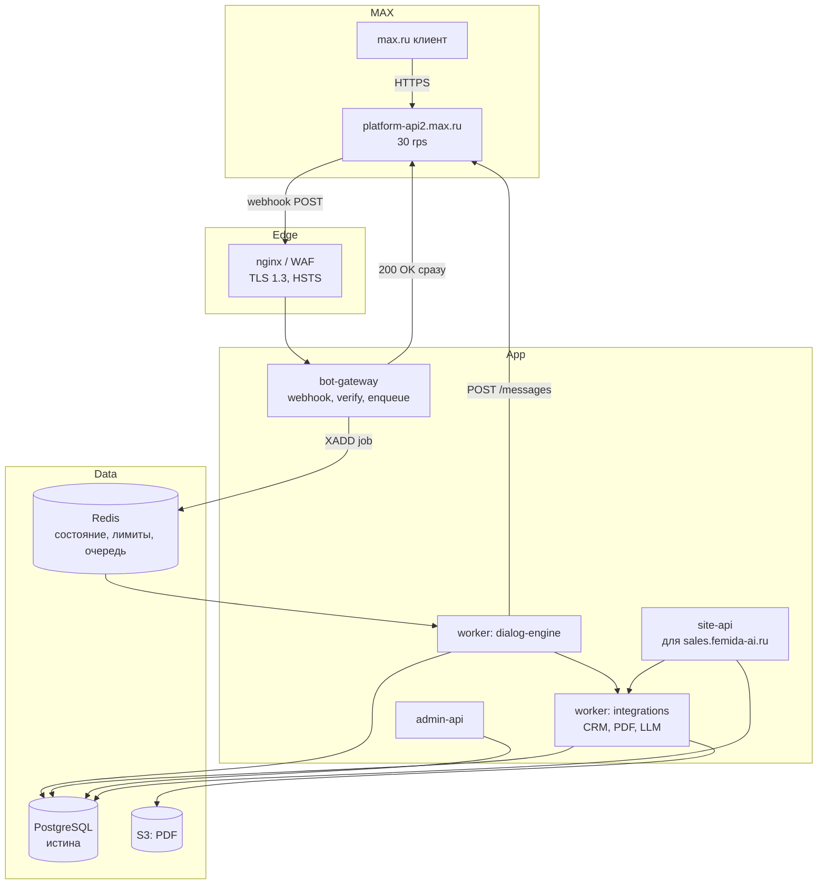
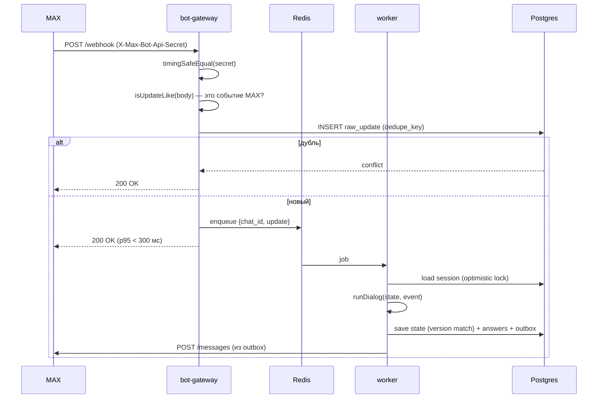
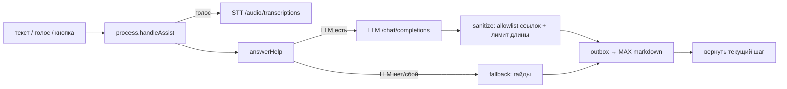

# Архитектура

## Общая схема



## Компоненты

| Компонент | Ответственность | Масштабирование |
|---|---|---|
| `bot-gateway` | принять webhook, проверить secret, провалидировать, записать raw, отдать 200, поставить job | stateless, 2+ реплики |
| `dialog-engine` | состояние, переходы, рендер сообщений, чек-лист | по `chat_id` |
| `integrations` | CRM, PDF, LLM, письма сайту | по типу job |
| `admin-api` | сценарии, документы, публикация, баны, просмотр сессий | 1–2 реплики |
| `site-api` | чек-лист для сайта, лиды, обмен с ботом | 2+ реплики |
| `scheduler` | напоминания, ретраи, очистка | singleton с локом |

## Поток webhook



Почему так:

- MAX ждёт **200 в течение 30 секунд**, иначе повторяет доставку (10 попыток,
  экспоненциально, до 8 часов, потом отписывается). Мы не работаем внутри запроса.
- Ретраи MAX + наши ретраи = дубли. Отсюда обязательная идемпотентность на входе.
- Порядок событий не гарантирован → сериализуем обработку **по chat_id**.

## Идемпотентность

У MAX нет отдельного `update_id`, поэтому ключ строим сами. В ключ берём
**стабильные** поля, а не весь payload и не `timestamp`:

```
// нажатие кнопки: callback.timestamp — время нажатия, а не доставки.
// Оно стабильно при ретрае и различает повторные нажатия той же кнопки.
dedupe_key = sha256(
  "message_callback:" + chat_id + ":" +
  callback.callback_id + ":" + callback.timestamp + ":" +
  callback.user.user_id + ":" + (callback.payload ?? "")
)

// новое сообщение: mid уникален
dedupe_key = sha256("message_created:" + chat_id + ":" + message.body.mid)

// редактирование: тот же mid, поэтому добавляем время сообщения
dedupe_key = sha256(
  "message_edited:" + chat_id + ":" + message.body.mid + ":" + message.timestamp
)

// служебные события без идентификатора: тип + чат + время события
dedupe_key = sha256(update_type + ":" + chat_id + ":" + timestamp)
```

Почему не `message.body.mid + callback.payload`: у одного сообщения `mid` не
меняется, а payload кнопки — тоже. Два разных нажатия «Да» на одном сообщении
получили бы одинаковый ключ, и второе нажатие потерялось бы. `callback.timestamp`
решает это и при этом не зависит от повторной доставки.

`Update.timestamp` — запасной вариант для событий без `mid`/`callback_id`. Ключ
должен описывать **событие**, а не момент его доставки.

- `raw_updates.dedupe_key` — `UNIQUE`.
- Повторный webhook получает 200 и ничего не делает.
- `timestamp` старше 10 минут не блокируем, но помечаем `late` и не выполняем
  повторные чувствительные действия (лид, оплата).
- Исходящие сообщения идут через **outbox**: запись в БД в одной транзакции с
  изменением состояния, отдельный воркер отправляет и помечает.
- Отправка — `at-least-once`. Чтобы не спамить при таймауте, на чат держим
  in-flight lock и сверяемся с последними сообщениями через `GET /messages`.

## Состояние диалога

```
Session {
  id, public_id,       // public_id — ULID для ссылок, не внутренний UUID
  user_id, scenario_code, scenario_version, catalog_version,
  state: jsonb,        // ответы + текущий шаг + флаги
  version: int,        // optimistic lock
  status: active | completed | abandoned | blocked,
  updated_at
}
```

Переход выполняется так:

```sql
SELECT * FROM sessions WHERE id = $1 FOR UPDATE;   -- или version = $2
-- pure function: transition(catalog, state, event) -> {state', outbox[]}
UPDATE sessions SET state = $3, version = version + 1 WHERE id = $1 AND version = $2;
```

`transition` — **чистая функция без I/O**. Это позволяет покрыть тестами все ветки
и проигрывать любой диалог из фикстуры.

### Почему свой движок, а не `ScenarioEngine` из SDK

Официальный `@maxhub/max-bot-api` содержит `ScenarioEngine` / `defineScenario` /
`transition`. Он **код-driven**: шаги — это функции TS, а состояние живёт в сессии
(по умолчанию в памяти процесса). Для нас это не подходит:

- сценарии — YAML, их пишет юрист/редактор; деплой кода на каждую правку текста
  не нужен;
- нужны версионирование контента и мультиреплика (состояние — в Postgres, а не
  в памяти процесса);
- нужна catalog-driven сборка чек-листа из `content/catalog.json`.

Поэтому граф диалога — наш `src/engine/*`. Из SDK берём транспорт: `Api`
(заголовок `Authorization`, лимиты), `Keyboard`, `fmt`. Это использование SDK по
назначению, а не отказ от него.

## Транспорт MAX

Отправка и правка сообщений, ответы на колбэки и клавиатуры — в `src/max/`
поверх официального SDK. Свой HTTP-клиент не пишем: SDK уже умеет заголовок
`Authorization`, диплинки и загрузки.

- `rate-limit.ts` — токен-бакет (25 rps); часы и `sleep` инъектируются, поэтому
  логика тестируется без реального времени;
- `fetch.ts` — обёртка над `fetch` **ниже** SDK (через `clientOptions.fetch`):
  таймаут, повторы с backoff и джиттером для 429/5xx и сетевых ошибок, учёт
  `Retry-After`;
- `keyboard.ts` — `StepView` → `inline_keyboard`, payload `{s,v}` и навигация;
- `client.ts` — `MaxClient`: `sendMessage`, `editMessage`, `answerCallback`,
  `getMe`; ловит HTTP 200 с `success:false` и бросает `MaxActionError`.

Всё проверяется без сети: лимит — с фейковыми часами, транспорт — с подменным
`fetch`. Токен проверяется командой `npm run max:check` (GET `/me`).

## Обработка события и воркер

Путь события собран из небольших модулей с явными зависимостями. Логика,
которую нужно проверять, отделена от I/O, поэтому тесты идут без Postgres,
Redis и сети.

| Модуль | Ответственность |
|---|---|
| `src/app.ts` | Fastify: `/healthz`, `/webhook`. Проверка секрета (`timingSafeEqual`), запись в `raw_updates`, постановка задачи. Собирается с зависимостями — маршруты тестируются через `inject()` |
| `src/server.ts` | HTTP-процесс: пул Postgres, соединение Redis, очередь; graceful shutdown |
| `src/updates.ts` | Разбор события MAX: `dedupe_key`, `late`, диалоговое событие. Чистые функции |
| `src/dialog/orchestrator.ts` | `runDialog`: состояние + событие → новое состояние и экраны. Ни БД, ни сети |
| `src/dialog/screens.ts` | Экраны → задания outbox: клавиатура, чек-лист, `idempotency_key` |
| `src/dialog/process.ts` | Обработка записи `raw_updates`: пользователь, сессия, `saveState` с оптимистичной блокировкой, ответы, outbox |
| `src/dialog/handle.ts` | Общий обработчик записи: ответ на колбэк, `processRawUpdate`, отметка статуса. Используют воркер и long polling |
| `src/dialog/deliver.ts` | Доставка outbox через MAX: успех, повтор с backoff, `dead` при исчерпании попыток |
| `src/store/` | Репозитории Postgres (`sessions`, `raw_updates`, `outbox`) над `Queryable`; соединение Redis и локи |
| `src/knowledge/guides.ts` | Гайды «где получить документ» из `content/guides.json`: загрузка, схема, allowlist ссылок |
| `src/llm/` | Подсказки по документам: OpenAI-совместимый клиент, сборка промпта, защита ссылок, откат |
| `src/stt/client.ts` | Распознавание речи (голос → текст) через OpenAI-совместимый `/audio/transcriptions` |
| `src/worker.ts` | Два BullMQ-воркера (`updates`, `outbox`) + периодическая доставка как страховка |
| `src/poll.ts` | Тот же путь без БД: события из `getUpdates`, хранилище в памяти. Прод-режим — `node dist/poll.js` |

Решения:

- **Ответ на колбэк** отправляется сразу в воркере, чтобы погасить индикатор
  ожидания в MAX; ошибка не критична.
- **Оптимистичная блокировка**: `saveState` пишет только при совпадении `version`.
  При конфликте сессия перечитывается и переход повторяется (до 3 раз).
- **Идемпотентность отправки**: `outbox.idempotency_key = sourceKey:stepId:index`,
  поэтому повторная обработка того же события не создаёт второй экран.
- **Дедупликация**: `raw_updates.dedupe_key` уникален, а `jobId` задачи равен id
  записи — повторный webhook не создаёт ни строку, ни задачу.
- **Отправка только через outbox**: все сетевые вызовы MAX (кроме ответа на
  колбэк) идут из `deliver.ts`, где действуют лимит частоты и повторы транспорта.
- **Возврат зависших отправок**: `claim` берёт и записи в статусе `sending`
  старше 2 минут, поэтому падение воркера между отправкой и отметкой не теряет
  сообщение.

## Асинхронность: что именно проверяем

| Гарантия | Как достигаем | Как проверяем |
|---|---|---|
| Webhook отвечает быстро | только валидация + enqueue | нагрузочный тест 300 rps, p95 < 300 мс |
| Нет двойных сообщений | dedupe_key, UNIQUE | реплей 100 одинаковых webhook |
| Нет потерянных событий | raw пишем до 200, job в Redis с AOF | kill -9 воркера в середине обработки |
| Нет гонок по чату | очередь partitioned by chat_id | 20 параллельных callback одного чата |
| Нет зависших сессий | TTL job, heartbeat, visibility timeout | тест с «зависшим» воркером |
| Долгие операции не блокируют | отдельные job + `action: typing` | PDF/LLM под нагрузкой |

## Хранилища

### PostgreSQL
Источник истины: пользователи, сессии, ответы, документы, сценарии, лиды,
raw_updates, outbox, audit. Схема — в `db/schema.sql`.

Версия сценария регистрируется в таблице `scenarios` при старте воркера
(`store.scenarios.register`): на `(code, version)` ссылается `sessions` по
внешнему ключу, поэтому строка обязана существовать до создания сессии.
`status`/`published_at` при повторной регистрации не трогаются — публикация
остаётся решением контент-команды.

Для локального запуска без БД есть хранилище в памяти (`src/store/memory.ts`)
с теми же интерфейсами `Store`; им пользуются `npm run poll` и тесты.

Миграции: `migrations/NNNN_name.sql` + `src/migrate.ts`. Каждый файл применяется
в своей транзакции, применённые отмечаются в `schema_migrations`. Запуск —
`npm run migrate` (dev) или `node dist/migrate.js` (прод); в Docker это сервис
`migrate`, который завершается до старта `app`. `db/schema.sql` — читаемая копия
базовой схемы, тест следит, что она не расходится с `0001_init.sql`.

`raw_updates.payload` содержит полный входящий `Update`, включая текст сообщения.
Это потенциальные ПД: хранить 30 дней, шифровать диск, не выгружать в общие логи,
доступ — только сервисной роли.

Партиционирование `raw_updates` и `audit_log` по месяцу — после 10 млн строк.

### Redis
Сейчас: очередь BullMQ и распределённые локи (`src/store/redis.ts`). Соединение
создаётся с `maxRetriesPerRequest: null` — требование BullMQ.

Дальше по плану:
- сессии hot-кэш (30 мин sliding, write-through);
- rate limit счётчики;
- идемпотентные ключи отправки;
- кэш рендера чек-листа.

### S3
PDF-чек-листы, сгенерированные один раз, ссылка с TTL 7 дней.
Сканы документов **не принимаем** в MVP.

## Деплой

```
Интернет → WAF/CDN → LB (443) → app (2+ пода)
                                  ├─ gateway
                                  ├─ worker
                                  └─ admin (за VPN/allowlist)
Postgres (managed, daily backup, PITR 7 дней)
Redis (managed, AOF)
S3 (версионирование, шифрование)
```

Требования, которые нельзя обойти:

- webhook **только HTTPS на 443**, сертификат от доверенного ЦС (в т.ч. Минцифры),
  полная цепочка. Самоподписанные и HTTP запрещены с 25.05.2026.
- исходящие к `platform-api2.max.ru` — не более **30 rps**; держим 25 с запасом.
- токен бота — только в заголовке `Authorization`, никогда в query и логах.

## Отказоустойчивость

| Сбой | Поведение |
|---|---|
| Redis упал | gateway отвечает 503 (MAX повторит), состояние в Postgres цело. 503 допустим только как короткая деградация: серия ошибок за 8 часов = отписка MAX |
| Воркер упал | job возвращается в очередь по visibility timeout |
| MAX API 5xx/429 | retry с backoff и jitter, лимит попыток, затем dead-letter |
| MAX вернул 200 + `success:false` | считать ошибкой, а не успехом; смотреть тело ответа |
| LLM недоступен | откат на кнопочный сценарий, без ошибки пользователю |
| CRM недоступен | лид сохраняется локально, ретрай, ручная выгрузка |
| Деплой | blue/green, миграции backward-compatible |

## Почему не «LLM отвечает на всё»

- Юридический чек-лист должен быть одинаковым при одинаковых ответах. LLM так не умеет.
- Галлюцинация про документы = потерянные деньги и репутация.
- Стоимость на диалог непредсказуема.
- Нельзя пройти ревью и тесты.

LLM включаем точечно: подсказка «как получить документ», пересказ утверждённого
гайда, классификация свободного текста. С валидацией выхода и fallback на гайды.

## Помощник (LLM + гайды + голос)

Перечень документов по-прежнему решает детерминированный движок. Помощник
отвечает только на **вопросы** и **не меняет состояние** диалога — после ответа
пользователю возвращается текущий шаг с кнопками.



- **Заземление.** Промпт собирается из каталога и гайдов (`buildHelpMessages`);
  system prompt отделён, данные — в отдельном user-сообщении.
- **Защита выхода.** `sanitizeLinks` вырезает все ссылки вне allowlist
  (официальные сервисы из гайдов + сайт), `clampAnswer` ограничивает длину. Это
  проверка в коде, а не просьба в промпте.
- **Откат.** Без `LLM_API_KEY` или при ошибке `answerHelp` возвращает ответ из
  гайдов (`source: fallback`), диалог не ломается.
- **Голос.** `src/stt/client.ts` скачивает аудио по `payload.url` и отправляет в
  `/audio/transcriptions`. DeepSeek речь не распознаёт — это отдельный сервис;
  без него голосовые вежливо отклоняются.
- **Гайды.** `content/guides.json` генерируется `npm run build:guides` из
  `source`/`note` каталога; помечены `review_status: draft` до ревью юриста.

## Визуал в MAX

- Сообщения отправляются с `format: markdown`: жирные заголовки, списки, цитата
  для дисклеймера, прогресс-бар по оставшимся вопросам.
- На каждом экране есть кнопка подсказки: «❓ Не понятно» на шаге и
  «❓ Как получить?» в чек-листе.
- Опциональная картинка-шапка на первом экране — `HERO_IMAGE_URL` (публичный
  URL). Картинку не генерируем автоматически: это настраиваемый ресурс.
