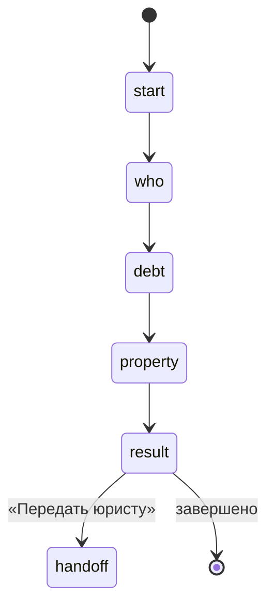

# Движок диалога

## Идея

Диалог — это **граф**, а не последовательность `if` в коде. Граф описан данными,
хранится в БД с версией и интерпретируется одним универсальным движком.



Свойства:

- переход — чистая функция `(scenario, session.state, event) → (state', messages[])`;
- все ветки проверяемы тестами без сети;
- новый сценарий = новый YAML, без деплоя кода (после ревью).

> Реальный каталог документов — `content/catalog.json`: 46 позиций, 9 источников,
> 13 условий (`pension`, `spouse`, `mortgage`, `ip`, …). Сценарий **не дублирует**
> перечень документов, а только описывает вопросы и правила условий. Пример ниже
> показывает формат, а не утверждённый юридический перечень.

## Формат сценария

Рекомендуемый режим — **catalog-driven**: ответы → 13 условий → правило документа
из `catalog.json` → чек-лист. Так бот и сайт используют одну правду.

```yaml
code: bankruptcy
version: 1
title: Банкротство физлица
status: draft          # draft | published | archived

# Показывается один раз в начале и в результате
disclaimer: >
  Это информационный сервис. Он не заменяет юридическую консультацию
  и не гарантирует результат.

start: who

steps:
  - id: who
    type: choice
    text: "Кто вы?"
    options:
      - { id: person, label: "Физлицо", next: debt }
      - { id: ip, label: "ИП", next: debt }
      - { id: selfEmployed, label: "Самозанятый", next: debt }
      - { id: unknown, label: "Не знаю", next: debt }

  - id: debt
    type: choice
    text: "Какая общая сумма долга?"
    options:
      - { id: under_100k, label: "До 100 тыс. ₽" }
      - { id: 100_500k, label: "100–500 тыс. ₽" }
      - { id: over_500k, label: "Больше 500 тыс. ₽" }
      - { id: unknown, label: "Не знаю" }
    next: property

  - id: property
    type: multi
    text: "Что из этого у вас есть?"
    min: 0
    options:
      - { id: flat, label: "Квартира или дом" }
      - { id: car, label: "Автомобиль" }
      - { id: land, label: "Земельный участок" }
      - { id: none, label: "Ничего из перечисленного", exclusive: true }
      - { id: unknown, label: "Не знаю", exclusive: true }
    next: result

  - id: result
    type: checklist
    source: catalog
    title: "Ваш список документов"

# Ответы → 13 условий сайта. Если условие не описано — false.
conditions:
  pension:
    when: { "in": ["pension", { "var": "answers.income" }] }
  social:
    when: { "in": ["social", { "var": "answers.income" }] }
  selfEmployed:
    when:
      "or":
        - { "==": [{ "var": "answers.who" }, "selfEmployed"] }
        - { "in": ["selfEmployed", { "var": "answers.income" }] }
  officialWork:
    when: { "in": ["salary", { "var": "answers.income" }] }
  realEstateDeal:
    when: { "==": [{ "var": "answers.deals" }, "yes"] }
  securedCredit:
    when: { "in": ["secured", { "var": "answers.credits" }] }
  mortgage:
    when: { "in": ["mortgage", { "var": "answers.credits" }] }
  creditCards:
    when: { "in": ["cards", { "var": "answers.credits" }] }
  ip:
    when: { "==": [{ "var": "answers.who" }, "ip"] }
  otherDebts:
    when: { "in": ["other", { "var": "answers.credits" }] }
  children:
    when: { "==": [{ "var": "answers.children" }, "yes"] }
  spouse:
    when: { "==": [{ "var": "answers.marital" }, "married"] }
  divorce:
    when: { "==": [{ "var": "answers.marital" }, "divorced"] }
```

> В примере выше для краткости опущены шаги `income`, `credits`, `deals`,
> `marital` и `children`, но условия на них ссылаются. Полный проверяемый
> набор — в `content/scenarios/example.yaml`; его проверяет
> `npm run check:content`. Юридический состав ещё утверждает юрист.

> `in` в JSONLogic: `{"in": [значение, массив]}`. Для `multi`-ответа массив
> стоит **вторым**, а не первым: `{"in": ["pension", {"var": "answers.income"}]}`.

Правила перехода:

- `next` на уровне шага — общий переход;
- `next` внутри `option` переопределяет шаг для конкретного ответа;
- если нет ни того, ни другого — ошибка публикации, а не «зависание»;
- `exclusive: true` — выбор снимает остальные (для «Ничего» и «Не знаю»);
- `conditions` содержит только 13 известных ключей; опечатка = ошибка CI.

### Состояние и вычисление чек-листа

`session.state` (jsonb):

```json
{
  "answers": { "who": "person", "income": ["salary", "pension"] },
  "current_step": "credits",
  "history": ["who", "debt", "property", "income"],
  "flags": { "disclaimer_shown": true }
}
```

- `choice`/`confirm` пишут строку, `multi` — массив строк; ответ всегда лежит
  под `answers.<step.id>`.
- `history` — для «Назад»; ответы при возврате не удаляются, а перезаписываются.
- «Назад» — это UI-операция, а не ребро графа: она берёт предыдущий шаг из
  `history` и не должна создавать цикл в YAML.

Вычисление `required` для документа:

```
if rule == "manual"   -> не обязательный, группа «уточнит юрист»
if rule == "always"   -> required = true
иначе                 -> required = conditions[rule] === true (по умолчанию false)
```

`exclusive` в `multi`: при выборе такого варианта остальные снимаются, и наоборот.
`min: 0` разрешает пустой выбор (пользователь ничего не выбрал и нажал «Далее»).

Служебные поля сценария:

| Поле | Зачем |
|---|---|
| `catalog` | путь к снимку каталога, по умолчанию `content/catalog.json` |
| `catalogVersion` | версия каталога, которую увидит сессия |
| `disclaimer` | обязательный текст в начале и в результате |
| `on_complete` | события и разрешённые действия после чек-листа (`export_pdf`, `open_site`, `handoff`) |

`on_complete` — декларация, а не исполняемый код: движок включает только
перечисленные действия и игнорирует остальные.

### Два режима чек-листа

| Режим | Когда использовать | Как работает |
|---|---|---|
| `source: catalog` | основной путь: банкротство и другие сценарии на каталоге сайта | ответы → `conditions` → `rule` документа |
| `documents` (явный список) | нестандартный сценарий, которого нет в каталоге | список кодов + необязательные `when` |

Явный список — исключение. Если документ уже есть в `catalog.json`, его **не
переписывают** в сценарий: иначе появятся две правды и бот разойдётся с сайтом.

### Типы шагов

| Тип | Назначение | Обязательные поля |
|---|---|---|
| `choice` | один вариант из списка | `text`, `options` |
| `multi` | несколько вариантов | `text`, `options` |
| `confirm` | строго да/нет | `text`; `options` не нужны |
| `info` | текст без вопроса, кнопка «Далее» | `text`, `next` |
| `checklist` | финальный результат | `title` + (`source: catalog` или `documents`) |
| `handoff` | сбор контакта и передача юристу | `text`, `consent_text` |

Для `confirm` движок сам рисует «Да / Нет / Не знаю». Если нужен третий
содержательный вариант — это `choice`, а не `confirm`.

### Условия

Условия — **JSONLogic**, а не `eval`. Никакого исполнения кода из контента.

```json
{"and": [
  {"==": [{"var": "answers.who"}, "person"]},
  {"in": [{"var": "answers.debt"}, ["100_500k", "over_500k"]]}
]}
```

### Каталог документов (отдельно от сценариев)

`catalog.json` — снимок каталога сайта. При импорте поля маппируются:

| В каталоге | В БД/движке | Смысл |
|---|---|---|
| `id` | `code` | стабильный код документа |
| `name` | `title` | название для клиента |
| `source` | `source` | где получить / откуда документ |
| `rule` | `rule` | `always`, `manual` или одно из 13 условий |
| `note` | `note` | подсказка менеджера, не инструкция |
| `commentable` | `commentable` | менеджерская метка; боту не нужна |

Инструкция «где получить» хранится отдельно от снимка каталога:

```yaml
code: other-passport          # = catalog.id
title: Паспорт                # = catalog.name
source: Прочие документы
rule: always
note: ""
how_to: |
  Оригинал и копии всех заполненных страниц.
links: []
ttl_days: 30                  # как часто проверять актуальность
reviewed_by: "юрист Иванов И.И."
reviewed_at: 2026-11-01
```

Так один документ переиспользуется в разных сценариях, а ссылки проверяются
централизованно. Если `how_to` нет — документ нельзя показывать клиенту как
готовую инструкцию; максимум — название и «уточнит юрист».

## Прогресс

Показываем не «шаг 3 из 8», а оценку по кратчайшему оставшемуся пути:

```
Осталось примерно 4 вопроса
[##########------] 60%
```

Если ветка длиннее, прогресс может «замереть» — это нормально, скачков назад быть
не должно. Считаем `remaining = min_depth(current_step, result)`.

## Помощник по документам

Помимо кнопочного сценария, у пользователя есть помощник, который отвечает на
вопросы «что это за документ» и «где его получить». Помощник **не меняет
состояние диалога**: после ответа пользователю возвращается текущий шаг с
кнопками.

Как его вызвать:

- свободный текст в чате (не команда) → вопрос помощнику;
- голосовое сообщение → STT → вопрос помощнику;
- команда `/help` → подсказка по текущему шагу;
- кнопка «❓ Не понятно» на шаге;
- кнопка «❓ Как получить?» в чек-листе → подсказка по документам списка.

Ответ строится **только** из каталога и гайдов `content/guides.json`:

- без `LLM_API_KEY` — откат: пошаговая инструкция из гайдов, собранная локально;
- с LLM — ответ модели, заземлённый на каталог и гайды, с проверкой выхода:
  ссылки вне allowlist вырезаются, длина ограничена;
- при любой ошибке LLM — снова откат на гайды, без ошибки пользователю.

Гайды генерируются `npm run build:guides` из `source`/`note` каталога и шаблонов
по сервису и помечены `review_status: draft` — до ревью юриста это подсказка, а
не юридическая инструкция.

## Защита от дурака

### В диалоге

| Ситуация | Поведение |
|---|---|
| Пользователь молчит | сессия живёт 30 дней, при возврате — продолжение с того же шага |
| Нажал «Назад» | возврат на предыдущий шаг, ответ сохраняется, можно изменить |
| Нажал «Начать заново» | подтверждение: «Ответы будут удалены. Продолжить?» |
| Отправил текст вместо кнопки | это вопрос помощнику: отвечаем и возвращаем текущий шаг (ответ кнопкой по-прежнему влияет на чек-лист) |
| Отправил голос | распознаём и отвечаем; без STT — просим написать текстом |
| Отправил фото/стикер | «Пока я понимаю только текст и кнопки» + текущий вопрос |
| Нажал кнопку дважды | повторная доставка того же callback игнорируется по `dedupe_key`; осознанное второе нажатие — новый ответ, без дубля сообщения |
| Долго не отвечает на вопрос | одно напоминание через 24 ч (только с согласием), не чаще 1 раза |
| Ответил противоречиво | не блокируем; в результате помечаем «уточнить у юриста» |
| Не знает ответ | вариант «Не знаю» на каждом шаге, влияет на чек-лист мягко |
| Ошибка сервера | «Что-то пошло не так, попробуйте ещё раз» + кнопка «Повторить»; состояние не теряется |
| Слишком длинный текст | обрезаем до лимита, не падаем |
| Спам / флуд | cooldown 1 сообщение/сек, при злоупотреблении — временная блокировка |

### В контенте (CI-проверки)

Публикация сценария блокируется, если:

1. есть переход на несуществующий шаг;
2. есть недостижимые шаги;
3. есть шаг без `next` и без терминального типа;
4. есть цикл, из которого нет выхода;
5. есть путь длиннее 40 шагов;
6. у `choice`/`multi` нет «Не знаю», «Другое» или `exclusive`-варианта;
7. текст шага пустой или длиннее лимита сообщения;
8. ссылка не `https://` или не отвечает 200;
9. в `conditions` ключ не из списка 13 условий;
10. `source: catalog` указан вместе с `documents` (или ни того, ни другого);
11. в явном `documents` код отсутствует в каталоге;
12. документ, видимый клиенту, не имеет `how_to` и хотя бы одной ссылки;
13. `disclaimer` отсутствует;
14. версия не увеличилась при изменении published-сценария.

Всё это — тесты в CI, а не «внимательность редактора». Быстрая локальная
проверка — `npm run check:content` (см. `AGENTS.md`). Проверка внешних ссылок
на 200 — отдельный сетевой job, он не должен блокировать офлайн-сборку.

### В коде

- `transition` не делает I/O и не бросает исключения на невалидном событии —
  возвращает `noop` + метрику.
- Неизвестный `callback.payload` → показываем текущий шаг + кнопки.
- Неизвестный `update_type` → 200, лог, метрика, никаких действий.
- Любая ошибка рендера → fallback-текст «Нажмите /start», инцидент в Sentry.

## Версионирование

- Сессия хранит `scenario_version` и идёт по ней до конца.
- Публикация новой версии не трогает активные сессии.
- Старые определения не удаляются (нужны для аудита и воспроизведения).
- «Начать заново» переводит на актуальную версию.
- `catalog.json` тоже версионируется: сессия запоминает версию каталога, чтобы
  чек-лист не менялся задним числом.

## Тон и тексты

- Обращение на «вы», без канцелярита.
- Один вопрос — один смысл.
- Никаких «осуществляется», «в соответствии с».
- В каждом результате: что делать дальше и куда идти.
- Никаких обещаний («спишем долги») и сроков («за 3 дня»).

## Тестирование

1. **Unit**: все переходы, условия, рендер.
2. **Property-based**: случайный проход по графу всегда завершается и не падает.
3. **Snapshot**: тексты сообщений и клавиатуры.
4. **Replay**: фикстуры реальных webhook (обезличенные) прогоняются через движок.
5. **Chaos**: дубли, ретраи, падение воркера, таймауты MAX.
6. **Content**: `npm run check:content` на каждый PR; ссылки — отдельным сетевым job.
7. **E2E в тестовом боте**: полный путь руками перед публикацией.
