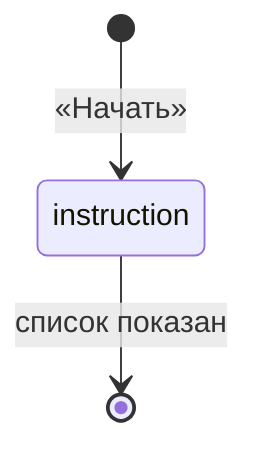

# Движок диалога

## Идея

Диалога-опросника больше нет. Задача бота — **сразу выдать инструкцию**: полный
список документов и как получить каждый. Сценарий описывает это данными, а не
кодом, и интерпретируется одним универсальным движком.



Свойства:

- переход — чистая функция `(scenario, session.state, event) → (state', messages[])`;
- все ветки проверяемы тестами без сети;
- новый сценарий = новый YAML, без деплоя кода (после ревью).

> Состав документов — `content/catalog.json`: 46 позиций, 9 источников.
> Шаги «где получить» — `content/guides.json`. Сценарий **не дублирует** ни то,
> ни другое: он лишь указывает, что показать инструкцию. Пример ниже показывает
> формат, а не утверждённый юридический перечень.

## Формат сценария

Сценарий — один **терминальный шаг `instruction`**. Документы и шаги получения
движок собирает из каталога и гайдов; в сценарии их нет.

```yaml
code: bankruptcy
version: 2
title: Банкротство физлица
status: draft          # draft | published | archived

# Показывается вместе с инструкцией
disclaimer: >
  Это информационный сервис. Он помогает собрать документы, но не заменяет
  юридическую консультацию и не гарантирует результат.

catalog: content/catalog.json
catalogVersion: "2026-11-19"

start: instruction

steps:
  - id: instruction
    type: instruction
    title: "Как получить документы"
```

Поля шага `instruction`: `id` (обязательно), `title` и/или `text` (что показать
заголовком). Вариантов ответа нет — это терминальный шаг.

Служебные поля сценария:

| Поле | Зачем |
|---|---|
| `catalog` | путь к снимку каталога, по умолчанию `content/catalog.json` |
| `catalogVersion` | версия каталога, которую увидит сессия |
| `disclaimer` | обязательный текст рядом с инструкцией |

### Состояние сессии

`session.state` (jsonb) — минимальное:

```json
{ "currentStep": "instruction" }
```

- `start` и `restart` сбрасывают сессию на `scenario.start`;
- событие `answer` (устаревшая кнопка ответа) и `back` возвращают `noop` —
  состояние не меняется и ничего не отправляется;
- истории шагов и ответов больше нет.

### Сборка инструкции

`buildInstruction(catalog, guides?)` группирует документы по сервису (порядок —
по первому появлению в каталоге) и для каждого берёт:

| Источник | Что даёт |
|---|---|
| каталог `catalog.json` | `code`, `title`, `note`, `rule`, `source` |
| гайды `guides.json` (если есть) | `how_to` — пошагово «где получить», `links`, `service` |

Гайды необязательны: без них список всё равно строится, а вместо шагов получения
показывается пометка из каталога или честное «Как получить — уточнит юрист».

Правило `manual` — менеджерская метка: такой документ показываем с пометкой
**«может понадобиться»**, а не как обязательный.

### Разбиение на сообщения

Инструкция длинная, поэтому `formatInstruction` режет её на несколько сообщений
MAX (лимит длины), **не разрывая документ между сообщениями**. Клавиатура идёт на
последнем сообщении, картинка-шапка — на первом. Порядок сообщений фиксирован,
`idempotency_key` — `<event_id>:instruction:<номер>`.

### Каталог документов (отдельно от сценариев)

`catalog.json` — снимок каталога сайта. При импорте поля маппируются:

| В каталоге | В движке | Смысл |
|---|---|---|
| `id` | `code` | стабильный код документа |
| `name` | `title` | название для клиента |
| `source` | `source` | сервис/источник («где получить») |
| `rule` | `rule` | `always`, `manual` или условие сайта |
| `note` | `note` | подсказка менеджера, не инструкция |
| `commentable` | `commentable` | менеджерская метка; боту не нужна |

Инструкция «где получить» хранится отдельно, в `content/guides.json`:

```json
{
  "code": "other-passport",       // = catalog.id
  "service": "Прочие документы",
  "how_to": "Оригинал и копии всех заполненных страниц.",
  "links": [],
  "review_status": "draft"        // до ревью юриста
}
```

Так один документ переиспользуется в разных сценариях, а ссылки проверяются
централизованно. Если `how_to` нет — документ нельзя показывать с готовой
инструкцией; максимум — название и «уточнит юрист».

## Помощник по документам

Помимо инструкции, у пользователя есть помощник: он отвечает на вопросы «что это
за документ» и «где его получить». Помощник **не меняет состояние диалога**: к
ответу прикладывается кнопка «Начать заново», чтобы вернуться к списку.

Как его вызвать:

- свободный текст в чате (не команда) → вопрос помощнику;
- голосовое сообщение → STT → вопрос помощнику;
- команда `/help` → подсказка по инструкции;
- кнопка «❓ Не понятно» на экране инструкции → подсказка по документам списка.

Ответ строится **только** из каталога и гайдов `content/guides.json`:

- без `LLM_API_KEY` — откат: пошаговая инструкция из гайдов, собранная локально;
- с LLM — ответ модели, заземлённый на каталог и гайды, с проверкой выхода:
  ссылки вне allowlist вырезаются, длина ограничена;
- при любой ошибке LLM — снова откат на гайды, без ошибки пользователю.

Гайды генерируются `npm run build:guides` из `source`/`note` каталога и шаблонов
по сервису и помечены `review_status: draft` — до ревью юриста это подсказка, а
не юридическая инструкция.

## Защита от дурака

### В диалоге

| Ситуация | Поведение |
|---|---|
| Пользователь молчит | сессия живёт 30 дней, при возврате — инструкция заново |
| Нажал «Начать заново» | инструкция показывается заново |
| Устаревшая кнопка ответа | `noop`: ничего не отправляем, состояние не меняем |
| Отправил текст | это вопрос помощнику: отвечаем и прикладываем «Начать заново» |
| Отправил голос | распознаём и отвечаем; без STT — просим написать текстом |
| Отправил фото/стикер | «Пока я понимаю только текст и кнопки» + кнопка возврата |
| Нажал кнопку дважды | повторная доставка того же callback игнорируется по `dedupe_key` |
| Ошибка сервера | «Что-то пошло не так, попробуйте ещё раз»; состояние не теряется |
| Слишком длинный текст | обрезаем до лимита, не падаем |
| Спам / флуд | cooldown 1 сообщение/сек, при злоупотреблении — временная блокировка |

### В контенте (CI-проверки)

Публикация блокируется, если:

1. `start` ссылается на несуществующий шаг;
2. есть дубль шага;
3. у шага нет `title` и `text`;
4. у документа нет гайда «где получить» (кроме помеченных как «уточнит юрист»);
5. ссылка в гайде не из allowlist официальных сервисов;
6. `disclaimer` отсутствует;
7. версия не увеличилась при изменении published-сценария.

Всё это — тесты в CI, а не «внимательность редактора». Быстрая локальная
проверка — `npm run check:content` (см. `AGENTS.md`). Проверка внешних ссылок
на 200 — отдельный сетевой job, он не должен блокировать офлайн-сборку.

### В коде

- `transition` не делает I/O и не бросает исключения на невалидном событии —
  возвращает `noop` + метрику.
- Неизвестный `callback.payload` → показываем инструкцию + кнопки.
- Неизвестный `update_type` → 200, лог, метрика, никаких действий.
- Любая ошибка рендера → fallback-текст «Нажмите /start», инцидент в Sentry.

## Версионирование

- Сессия хранит `scenario_version` и идёт по ней до конца.
- Публикация новой версии не трогает активные сессии.
- Старые определения не удаляются (нужны для аудита и воспроизведения).
- «Начать заново» переводит на актуальную версию.
- `catalog.json` тоже версионируется: сессия запоминает версию каталога, чтобы
  список не менялся задним числом.

## Тон и тексты

- Обращение на «вы», без канцелярита.
- Никаких «осуществляется», «в соответствии с».
- В инструкции — что делать дальше и куда идти.
- Никаких обещаний («спишем долги») и сроков («за 3 дня»).

## Тестирование

1. **Unit**: переходы, рендер, сборка инструкции.
2. **Content**: `npm run check:content` на каждый PR; ссылки — отдельным сетевым job.
3. **Replay**: фикстуры реальных webhook (обезличенные) прогоняются через движок.
4. **Chaos**: дубли, ретраи, падение воркера, таймауты MAX.
5. **E2E в тестовом боте**: «Начать» руками перед публикацией.
