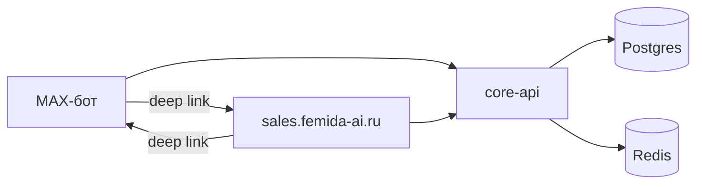

# Интеграция с сайтом

## Принцип

Сайт и бот — **два клиента одного backend**. Нет «синхронизации двух систем»:
чек-лист, созданный в боте, открывается на сайте по id, и наоборот.



## Что уже реализовано на сайте

| Возможность | Где | Как использовать |
|---|---|---|
| Каталог 46 документов | JS-бандл `/documents` | выгружен в `content/catalog.json` |
| Разбор анкеты в 13 условий | `POST /api/documents-conditions` | свободный текст / готовая анкета |
| Ответы по регламентам | `POST /api/rules-chat` | пошаговые инструкции, «что запросить» |
| Цены | `GET /api/price-list` | калькулятор, если нужен |
| Экспорт списка | клиентский `.doc` | заменить на серверный PDF/DOC |

Важно: все эти API сейчас закрыты cookie-сессией продаж. Боту нужен **отдельный
сервисный токен**, а не пароль от сайта.

## Переход сайт → бот

На сайте кнопка «Подобрать документы в MAX». Ссылка:

```
https://max.ru/<botName>?start=s_7Q3kL9mN2pR5tV8x
```

- `payload` — **одноразовый токен**, не ПД и не id пользователя;
- длина ≤ 128 символов (ограничение платформы);
- в `start_tokens` хранится **хэш**: `token_hash = sha256(token)`, `scenario_code`,
  `scenario_version`, `utm`, `expires_at` (15 мин), `used_at`. Сам токен в БД
  не хранится: утечка базы не даёт переиграть переход;
- при `bot_started` бот хэширует payload, ищет запись, выбирает сценарий и сразу
  начинает;
- повторный переход по тому же токену — просто приветствие.

Почему не `?start=user_12345`: это утечка идентификатора, перебор и связка
«сайт ↔ соцпрофиль» без согласия.

## Переход бот → сайт

После результата бот даёт кнопку «Открыть на сайте»:

```
https://sales.femida-ai.ru/c/<signed-token>
```

- подписанный токен (Ed25519/HS256), внутри только `public_id` сессии, `exp`, `ver`;
- TTL 7 дней, одноразовость не обязательна (это просмотр своего чек-листа);
- сайт обменивает токен на данные через бот: `GET /internal/v1/checklists/:public_id`;
- `public_id` — ULID из `sessions.public_id`, а не внутренний UUID;
- никаких ПД и ответов в URL.

Если сайт за паролем — токен **не обходит** пароль: он даёт доступ только к
конкретному чек-листу, остальные разделы остаются закрытыми.

## Внутренний API

Направления не смешивать: у каждого свой токен и свой владелец API.

- `INTERNAL_API_TOKEN` — сайт вызывает **бота** (`/internal/v1/*`);
- `SITE_SERVICE_TOKEN` — бот вызывает **сайт** (`/api/documents-conditions`,
  `/api/rules-chat`).

Это разные секреты с разными правами. Один общий токен = лишняя зона поражения.

### Бот предоставляет сайту

Авторизация: `Authorization: Bearer <INTERNAL_API_TOKEN>` + `X-Signature` (HMAC
от тела и timestamp), IP allowlist.

| Метод | Путь | Назначение |
|---|---|---|
| POST | `/internal/v1/checklists` | создать чек-лист по сценарию и ответам |
| GET | `/internal/v1/checklists/:public_id` | получить чек-лист |
| PATCH | `/internal/v1/checklists/:public_id/items/:code` | отметить «собрано» |
| POST | `/internal/v1/leads` | передать заявку юристу |
| POST | `/internal/v1/events` | событие сайта (оплата, регистрация) |
| POST | `/internal/v1/notify` | попросить бота отправить сообщение |

`POST /internal/v1/bot-links` выпускает deep link: бот генерирует одноразовый
токен, кладёт в `start_tokens` **хэш**, возвращает готовый
`https://max.ru/<botName>?start=<token>`. Сайт сам токен не хранит.

### Сайт предоставляет боту

Авторизация: `Authorization: Bearer <SITE_SERVICE_TOKEN>`.

| Метод | Путь | Назначение |
|---|---|---|
| POST | `/api/documents-conditions` | разобрать анкету в 13 условий |
| POST | `/api/rules-chat` | ответ по регламентам |
| GET | `/api/price-list` | цены, если нужен калькулятор |

`POST /internal/v1/start-tokens/:token/resolve` — не публичный API, а внутренний
шаг бота при `bot_started`: бот хэширует payload и ищет `token_hash`.

## Формат чек-листа

Единый для бота, сайта и PDF:

```json
{
  "id": "01JCHK...",              // = sessions.public_id (ULID), не внутренний UUID
  "scenario": { "code": "bankruptcy", "version": 3, "title": "Банкротство физлица" },
  "created_at": "2026-11-19T13:40:00Z",
  "items": [
    {
      "code": "other-passport",
      "title": "Паспорт",
      "required": true,
      "status": "collected",
      "how_to": "Оригинал и копии заполненных страниц.",
      "links": [{ "title": "Госуслуги", "url": "https://www.gosuslugi.ru/" }],
      "note": ""
    }
  ],
  "disclaimer": "Это информационный сервис..."
}
```

`status`: `todo` | `collected` | `not_applicable`.
`required` вычисляется по ответам, а не хранится в сценарии жёстко. Документы с
правилом `manual` не получают `required: true`: они идут отдельной группой
«уточнит юрист», чтобы клиент не считал их обязательными.

## События сайт → бот

Сайт может инициировать сообщение (только если пользователь дал согласие
на уведомления):

| Событие | Что делает бот |
|---|---|
| `consultation.paid` | «Оплата получена, юрист свяжется до 18:00» |
| `document.uploaded` | «Документ получен, проверяем» |
| `lead.assigned` | «С вами работает юрист N» |
| `checklist.reminder` | напоминание о незакрытых пунктах |

Реализация: `POST /internal/v1/notify` → outbox → MAX. Не чаще 1 сообщения в сутки
на пользователя, кроме транзакционных.

## UTM и аналитика

В `start_tokens.utm` (jsonb) сохраняем `utm_source/medium/campaign` (≤ 120 символов вместе).
Атрибуция: `bot_started → checklist_ready → lead` с источником. Без cookies и
без передачи ПД.

## Мини-приложение (v2)

Если понадобится полноценный UI внутри MAX:

- MAX Bridge для событий;
- валидация `initData` на сервере (обязательно, см. документацию MAX);
- тот же `core-api`;
- бот остаётся точкой входа, мини-апп — «тяжёлый» экран чек-листа.

На MVP не нужно: бот + веб-страница закрывают сценарий дешевле.

## Ограничения платформы

- Бот доступен только после модерации и верификации профиля организации/ИП.
- Бот нельзя добавить в личный диалог — пользователь сам запускает его.
- Webhook: только HTTPS/443, доверенный сертификат, ответ 200 за 30 с.
- 30 rps на API — общий лимит, включая исходящие сообщения.
- Правила платформы запрещают авторизационные сообщения через deep links.
