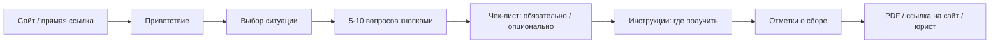

# Продукт

## Проблема

Человек приходит с юридической ситуацией («банкротство», «взыскание», «субсидия»),
не понимает, какие документы нужны, где их брать и в каком порядке. Он теряет время,
приносит неполный пакет, возвращается. Консультант тратит первые 15 минут на одно и
то же — на сбор справок.

Бот снимает эту рутину: выдаёт персональный чек-лист до первого контакта с юристом
и доводит человека до готового пакета.

## Пользователи

| Роль | Что делает | Что важно |
|---|---|---|
| Клиент | Отвечает на вопросы, собирает документы | Понятные кнопки, без юридического языка, можно вернуться |
| Юрист | Получает лид с готовым чек-листом и ответами | Видеть, что уже собрано, что нет |
| Контент-редактор | Ведёт сценарии, документы, инструкции | Не трогать код, версии, предпросмотр |
| Админ | Смотрит метрики, баны, ошибки | Быстрый доступ к диалогу и логам |

## Основной путь



### Экран 1. Приветствие

```
Здравствуйте! Я помогу собрать документы под вашу ситуацию.

Отвечу на несколько вопросов и составлю персональный список —
что нужно, где получить и на что нажать.

Это займёт 2–3 минуты. Ответы используются только для подбора документов.
Сканы документов не загружаются. Передача юристу — только по вашему согласию.

[Подобрать документы]  [Как это работает]
```

### Экран 2. Выбор ситуации

Кнопки, не свободный текст:

```
С чем нужна помощь?
[Банкротство физлица]
[Взыскание долга]
[Спор с работодателем]
[Другое / не знаю]
```

### Экран 3. Вопросы

Один вопрос — один экран. Всегда есть «Не знаю» и «Назад».

```
Осталось примерно 5 вопросов
[##########------] 60%

Есть ли у вас просрочка больше 3 месяцев?
[Да] [Нет] [Не знаю] [Назад]
```

Не пишем «шаг 3 из 8»: у сценария есть ветки, и точное число шагов зависит от
ответов. Оценка по кратчайшему пути честнее и не «прыгает» назад.

### Экран 4. Результат

```
Готово. Вот ваш список.

Сначала соберите (5):
1. Паспорт — оригинал и копия заполненных страниц
2. СНИЛС
...

[Показать ещё 8 обязательных]

Уточнит юрист (2):
- документы, которые зависят от ситуации

[Как получить каждый] [Скачать PDF] [Отметить собранные]
[Передать юристу]
```

Важно: в каталоге 13 документов с правилом `always` — это обязательные для всех.
Показывать все 13 сразу нельзя, но и прятать их нечестно. Поэтому progressive
disclosure: 5–7 ключевых сразу, остальные — под кнопкой «Показать ещё», с тем же
статусом «обязательно». Документы с `manual` не попадают в обязательные: только
«уточнит юрист». Итоговое число зависит от ответов, поэтому «9 документов» в
макете — пример, а не константа.

### Экран 5. Инструкция по документу

Пошагово, с точными адресами и кнопками:

```
Справка о доходах (2-НДФЛ)

1. Зайдите на gosuslugi.ru и войдите через Госуслуги
2. Раздел «Доходы и налоги» → «Сведения о доходах»
3. Нажмите «Запросить справку»
4. Выберите год и нажмите «Сформировать»
5. Готовая справка появится в «Уведомлениях» через 1–3 дня

[Открыть Госуслуги] [Я собрал] [Назад]
```

## Границы продукта

**Бот делает:** собирает факты, выдаёт чек-лист, объясняет порядок получения,
сохраняет прогресс, передаёт заявку.

**Бот не делает:** не консультирует по существу спора, не оценивает шансы,
не гарантирует результат, не заменяет юриста, не хранит сканы документов
(в MVP — только отметки «собрано»).

Эти границы — не формальность: они снимают юридические риски и резко упрощают
безопасность (нет загрузки паспортов и выписок).

## Метрики

Воронка (считаем на каждом шаге):

```
start → scenario_selected → q1..qN → checklist_ready → export/pdf → lead
```

| Метрика | Цель MVP | Как считаем |
|---|---|---|
| Доля дошедших до чек-листа | ≥ 55% | session_started → checklist_ready |
| Среднее время до чек-листа | ≤ 3 мин | completed_at − started_at |
| Отвал на шаге | ≤ 15% | step_view → step_answer |
| Возвраты | ≥ 20% | повторный вход в течение 7 дней |
| Лиды юристу | ≥ 5% | lead_created / checklist_ready |
| Стоимость диалога | ≤ 0,5 ₽ | токены + инфраструктура |

Отдельно — **качество чек-листа**: доля лидов, где юрист не добавил документы
вручную. Цель ≥ 80%. Это главная продуктовая метрика, а не количество сообщений.

## MVP / v1 / v2

### MVP (4–6 недель)
- один сценарий, 8–10 шагов, ~15 документов;
- кнопки, назад, «не знаю», сохранение прогресса;
- чек-лист + инструкции + PDF/ссылка;
- webhook, идемпотентность, лимиты, логи;
- админка: редактирование YAML, предпросмотр, публикация версии.

Не путать с **прототипом за 1–2 недели**: один сценарий на тестовых данных,
без админки, PDF и CRM. Прототип нужен, чтобы показать логику и снять вопросы,
а не чтобы заменить MVP.

### v1
- 3–5 сценариев;
- лид в CRM и уведомление юристу;
- напоминания (по согласию), «продолжить с места»;
- аналитика воронки, A/B текстов;
- мини-приложение MAX или веб-чек-лист на сайте.

### v2
- LLM-ассистент: свободный вопрос → ответ по базе знаний с цитатами;
- распознавание фото документа (без хранения) — определить тип и подсказать;
- мультиязычность, региональные особенности;
- партнёрские сценарии (банки, МФЦ).

## Риски

| Риск | Что делаем |
|---|---|
| Юридически неверный чек-лист | контент проходит ревью юриста, версии, дата актуальности |
| Ссылки на госсайты устарели | проверка ссылок в CI + ежемесячный ревью |
| Бот выглядит как юрист | дисклеймер в приветствии и в каждом результате |
| Пользователь не понимает вопрос | «не знаю» на каждом шаге, простые формулировки |
| Спам и накрутка | лимиты, капча-подобный шаг при аномалиях, бан |
| Дорого из-за LLM | LLM только на свободный текст, кэш ответов, дешёвая модель |
