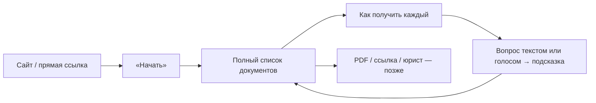

# Продукт

## Проблема

Человек приходит с юридической ситуацией («банкротство», «взыскание», «субсидия»),
не понимает, какие документы нужны, где их брать и в каком порядке. Он теряет время,
приносит неполный пакет, возвращается. Консультант тратит первые 15 минут на одно и
то же — на сбор справок.

Бот снимает эту рутину: **сразу выдаёт полный список документов и как получить
каждый**, чтобы человек пришёл с готовым пакетом или понимал, что его ждёт.

## Пользователи

| Роль | Что делает | Что важно |
|---|---|---|
| Клиент | Читает список, собирает документы, задаёт вопросы | Понятный список без юридического языка, подсказка по каждому пункту |
| Юрист | Получает клиента с готовым пакетом | Что уже собрано, что нет |
| Контент-редактор | Ведёт каталог, гайды, инструкции | Не трогать код, версии, предпросмотр |
| Админ | Смотрит метрики, баны, ошибки | Быстрый доступ к диалогу и логам |

## Основной путь



Опросника нет: список общий, редкие документы помечены «может понадобиться».

### Экран 1. Инструкция (после «Начать»)

Приходит сразу, без вопросов. Из-за лимита длины MAX список разбит на несколько
сообщений, но ни один документ не рвётся между сообщениями.

```
Как получить документы

Всего документов: 46. Ниже — что нужно и как получить каждый.

Портал Госуслуг — https://www.gosuslugi.ru

Выписка из ЕГРН о недвижимом имуществе
Как получить: зайдите на Госуслуги, в поиске введите название услуги...
Ссылка: Портал Госуслуг — https://www.gosuslugi.ru

Супруг: справка о доходах (может понадобиться)
...
```

В конце — дисклеймер: сервис информационный, перечень подтверждает юрист.

Кнопки на последнем сообщении: «❓ Не понятно» и «Начать заново».

### Экран 2. Помощник

Пользователь задаёт вопрос текстом или голосом — помощник отвечает, **где взять
конкретный документ**, и прикладывает кнопку «Начать заново», чтобы вернуться к
списку. Помощник не меняет список и не выдумывает документы: отвечает по каталогу
и гайдам, ссылки вне официальных сервисов вырезаются.

## Границы продукта

**Бот делает:** показывает полный список документов, объясняет порядок получения,
отвечает на вопросы по конкретному документу, передаёт заявку юристу.

**Бот не делает:** не консультирует по существу спора, не оценивает шансы,
не гарантирует результат, не заменяет юриста, не хранит сканы документов.

Эти границы — не формальность: они снимают юридические риски и резко упрощают
безопасность (нет загрузки паспортов и выписок).

## Метрики

Воронка:

```
start → instruction_shown → doc_question → lead
```

| Метрика | Цель MVP | Как считаем |
|---|---|---|
| Доля дошедших до списка | ≥ 80% | session_started → instruction_shown |
| Вопросы помощнику | ≥ 20% | doc_question / instruction_shown |
| Возвраты | ≥ 20% | повторный вход в течение 7 дней |
| Лиды юристу | ≥ 5% | lead_created / instruction_shown |
| Стоимость диалога | ≤ 0,5 ₽ | токены + инфраструктура |

Отдельно — **качество списка**: доля лидов, где юрист не добавил документы
вручную. Цель ≥ 80%. Это главная продуктовая метрика, а не количество сообщений.

## MVP / v1 / v2

### MVP (4–6 недель)
- один сценарий: полный список 46 документов и как получить каждый;
- помощник по документам (текст и голос), кнопка «Начать заново»;
- webhook, идемпотентность, лимиты, логи;
- админка: редактирование каталога и гайдов, предпросмотр, публикация версии.

Не путать с **прототипом за 1–2 недели**: один сценарий на тестовых данных,
без админки, PDF и CRM. Прототип нужен, чтобы показать логику и снять вопросы,
а не чтобы заменить MVP.

### v1
- 3–5 наборов документов под разные ситуации;
- лид в CRM и уведомление юристу;
- PDF-список и веб-версия на сайте;
- аналитика воронки, A/B текстов;
- мини-приложение MAX.

### v2
- LLM-ассистент: свободный вопрос → ответ по базе знаний с цитатами;
- распознавание фото документа (без хранения) — определить тип и подсказать;
- мультиязычность, региональные особенности;
- партнёрские сценарии (банки, МФЦ).

## Риски

| Риск | Что делаем |
|---|---|
| Юридически неверный список | контент проходит ревью юриста, версии, дата актуальности |
| Ссылки на госсайты устарели | проверка ссылок в CI + ежемесячный ревью |
| Бот выглядит как юрист | дисклеймер рядом с инструкцией |
| Слишком длинное сообщение | разбиение на несколько сообщений без разрыва документа |
| Спам и накрутка | лимиты, капча-подобный шаг при аномалиях, бан |
| Дорого из-за LLM | LLM только на свободный текст, кэш ответов, дешёвая модель |
